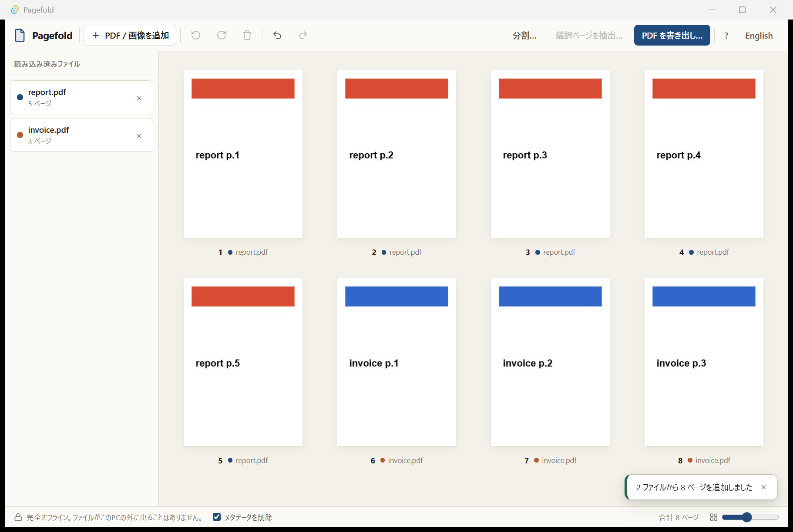

# Pagefold

**PDF の結合・並べ替え・回転・削除・抽出・分割を視覚的に行える、完全オフラインの軽量デスクトップアプリ**。確定申告書や契約書、身分証スキャンを外部サーバーにアップロードすることなく、iLovePDF のような直感的操作をローカル環境だけで完結できます。

> [!NOTE]
> **100% オフライン & プライバシー重視。** Pagefold は外部通信・アカウント登録・テレメトリを一切行いません。ファイルがこの PC の外に出ることはありません。



## 特徴 (v0.2)

- **PDF / 画像の追加**: PDF・PNG・JPEG をウィンドウにドラッグ＆ドロップ（ドロップ位置に挿入）、またはファイル選択ダイアログから追加できます。
- **ページサイズの正規化**: ステータスバーの **ページサイズ** から書き出しサイズを選択可能：*最初のPDFに合わせる*（標準・画像の向きに合わせて縦横を自動切替）、*A4* / *Letter*（PDF・画像すべてをベクター品質と回転を保ったまま均等縮小・中央配置）、*元のサイズ*（画像は 96 dpi 換算）。
- **注釈機能（テキスト・四角形・ハイライト）**: `E` キーやツールバーの編集ボタン（またはクイックプレビュー）から、テキスト・四角形・ハイライト（透明度 35%）を追加できます。カラー選択、文字サイズ（`10`〜`32 pt`）、ドラッグ移動、リサイズハンドル、Undo/Redo に対応し、サムネイル上にもプレビューとバッジを表示します。（※ v0.2 ではテキスト注釈は書き出し時に高解像度画像としてフラット化されるため、選択可能なテキストにはなりません）
- **サムネイルグリッド**: `IntersectionObserver` による遅延描画で 300 ページ超の PDF でも軽快に動作。ステータスバーのスライダーまたは `Ctrl+ホイール` でサムネイルサイズを変更でき、サイドバーのファイルをクリックすると該当ページの全選択ができます。
- **クイックプレビュー**: ページをダブルクリックまたは `Space` で拡大表示し、`←` / `→` でページ送り、`R` / `Shift+R` で回転、注釈の編集ができます。
- **複数選択 & 並べ替え**: クリック、`Ctrl/Cmd+クリック`、`Shift+クリック`、`Ctrl/Cmd+A` で選択し、ドラッグ＆ドロップや `Alt+←` / `Alt+→` で並べ替えられます。
- **回転・削除・元に戻す/やり直し**: ±90° 回転 (`R` / `Shift+R`)、削除 (`Delete` / `Backspace`)、Undo/Redo (`Ctrl+Z` / `Ctrl+Shift+Z` / `Ctrl+Y`) に対応。
- **書き出し・抽出・分割**:
  - **PDF を書き出し…** — 現在の並び順ですべてのページを保存
  - **選択ページを抽出…** — 選択中のページだけを保存
  - **分割…** — N ページごと、または `1-3, 5, 8-10` のような範囲指定でフォルダへ連番出力
- **プライバシー保護が標準**: **メタデータを削除** がデフォルト ON。作成者・タイトル・Producer・XMP メタデータを除去して書き出します。
- **日英バイリンガル & ダークモード**: OS 言語から自動判定し、ヘッダーからワンクリックで英語/日本語を切り替え可能。ライト/ダークモードにも対応しています。

## キーボードショートカット

| ショートカット | 操作 |
| --- | --- |
| `クリック` | ページを選択 |
| `Ctrl` / `Cmd` + `クリック` | 選択を追加・解除 |
| `Shift` + `クリック` | 範囲選択 |
| `Ctrl` / `Cmd` + `A` | すべて選択 |
| `Esc` | 選択解除 / ダイアログを閉じる |
| `Alt` + `←` / `→` | 選択ページを左右に移動 |
| `R` / `Shift` + `R` | 選択ページを ±90° 回転 |
| `Delete` / `Backspace` | 選択ページを削除 |
| `Ctrl` + `Z` / `Ctrl` + `Shift` + `Z` | 元に戻す / やり直す |
| `Space` / `ダブルクリック` | クイックプレビュー |
| `E` | 選択ページに注釈を追加 |
| `V` / `T` / `B` / `H` | 注釈ツール: 選択 / テキスト / 四角形 / ハイライト |
| `Ctrl` + `ホイール` | サムネイルサイズ変更 |
| `?` | ショートカット一覧を表示 |

## ソースからのビルド

```bash
npm install
npm test
npm run build
npm run tauri build
```

## ロードマップ

- パスワード付き PDF の解除・暗号化
- 完全な墨消し（フラット化）
- 空白ページの挿入
- ページの PNG 書き出し
- PDF 圧縮・ローカル OCR

## ライセンス

MIT © [Pagefold contributors](LICENSE)
