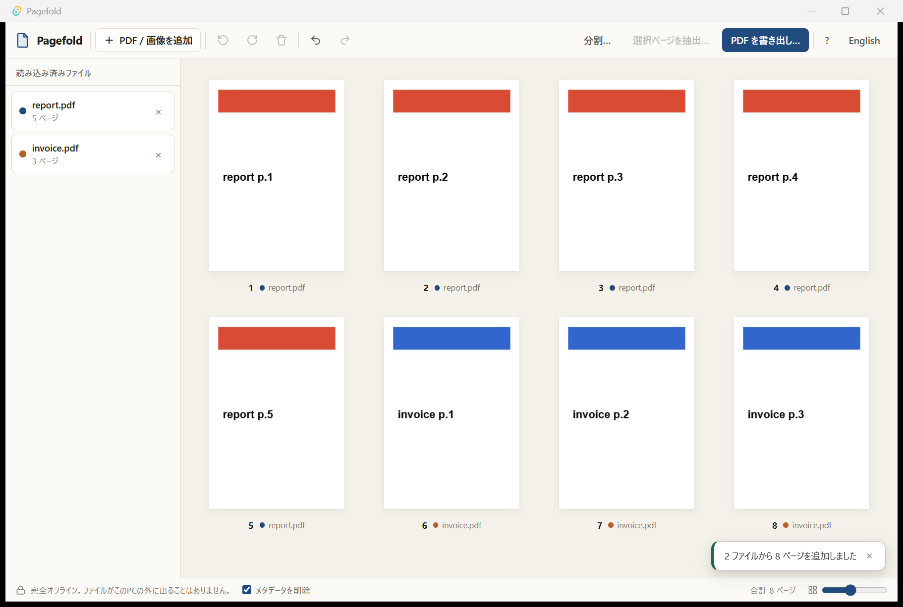

English | [日本語](README.ja.md)

# Pagefold

Pagefold is a small, offline desktop app for organizing PDF pages. People routinely upload tax returns, contracts, and ID scans to web PDF tools just to reorder a few pages or rotate a sideways scan. Pagefold keeps that work on your machine. It is built with Tauri v2, `pdf-lib`, and a locally bundled `pdf.js` worker, and ships at v0.3.0 as a ~6 MB Windows executable (~2.4 MB installer).



## Download

Prebuilt binaries for Windows, macOS (universal), and Linux are published on the [GitHub Releases](https://github.com/NYEnuWai-2nd/pagefold/releases) page via GitHub Actions whenever a version tag is pushed.

Release binaries are currently unsigned:

- **Windows (SmartScreen)**: Click "More info", then "Run anyway".
- **macOS (Gatekeeper)**: Right-click the app in Finder and choose "Open".

## What it does

### Pages and files

Drop PDF, PNG, or JPEG files onto the desk to insert them at the drop position, or add them from the file picker. You can also pass files through your file manager's "Open with" menu or from the command line (`pagefold.exe a.pdf b.pdf`).

Pages can be multi-selected, reordered by dragging or with `Alt+←` / `Alt+→`, rotated ±90°, and deleted, with full undo and redo. The sidebar lists loaded source files with color tags; clicking a file selects all of its pages.

### Preview and thumbnails

Press `Space` or double-click any page to open the quick-look preview, where you can step through pages and rotate them. Thumbnails render lazily as you scroll and resize with the status-bar slider or `Ctrl+Wheel`.

### Export, extract, and split

- **Export PDF…** saves all pages in their current order.
- **Extract Selected…** saves only the selected pages.
- **Split…** writes separate files every N pages or by custom ranges such as `1-3, 5, 8-10`.

**Remove metadata** is on by default on export.

### Page size normalization

Choose a target in the status-bar **Page size** menu: *Match first PDF page* (default), *A3*, *A4*, *A5*, *B4 (JIS)*, *B5 (JIS)*, *Letter*, *Legal*, or *Original size*. Fixed paper sizes scale each page uniformly to fit with blank margins while preserving vector content and page rotation.

### Image compression

Set **Compress** in the status bar to *Light*, *Standard*, or *Strong* to downscale and re-encode embedded JPEG images (100 KB and larger) during export, extract, or split. Vector text stays selectable. CMYK, JBIG2, and CCITT images are left untouched. After saving, a toast shows the size before and after.

### Annotations

Press `E` or click the Annotate button to add text notes, rectangles, and highlights (35% opacity) inside the preview editor, with color swatches, text sizes from 10 to 32 pt, drag/resize handles, and undo/redo. Text annotations are exported as real selectable PDF text using an OS font (Yu Gothic, Hiragino, or Noto CJK) with glyph subsetting, falling back to a high-DPI image overlay if no suitable font or glyph is available.

### Interface

The UI supports English and Japanese with automatic locale detection and a header toggle, and follows system light and dark mode.

## Keyboard shortcuts

| Shortcut | Action |
| --- | --- |
| `Click` | Select page |
| `Ctrl` / `Cmd` + `Click` | Toggle page in selection |
| `Shift` + `Click` | Select range |
| `Ctrl` / `Cmd` + `A` | Select all pages |
| `Esc` | Clear selection / close dialog |
| `Alt` + `←` / `→` | Move selected pages left / right |
| `R` / `Shift` + `R` | Rotate selected ±90° |
| `Delete` / `Backspace` | Delete selected pages |
| `Ctrl` + `Z` / `Ctrl` + `Shift` + `Z` | Undo / Redo |
| `Space` / `Double-click` | Quick-look preview |
| `E` | Annotate selected page |
| `V` / `T` / `B` / `H` | Select / Text / Rectangle / Highlight |
| `Ctrl` + `Wheel` | Resize thumbnails |
| `?` | Toggle keyboard shortcuts guide |

## Privacy

All PDF parsing, thumbnail rendering, and export assembly run locally inside the app. The `pdf.js` worker is bundled into the binary, and a strict Content-Security-Policy blocks remote origins. There is no account system, no telemetry, and no network traffic at runtime. **Remove metadata** is enabled by default so exported files do not carry over title, author, producer, creator, or XMP metadata.

## Limitations

- **Memory usage on scanned PDFs**: Image-heavy scans consume significant RAM during rendering and export—roughly 570 MB of private memory for 50 A4 pages at 300 dpi.
- **Encrypted PDFs**: Password-protected PDFs cannot be opened yet.
- **Compression scope**: Only embedded JPEG (`DCTDecode`) streams of at least 100 KB are re-encoded. CMYK, JBIG2, CCITT, PNG-like flate streams, and smaller images are left as-is.
- **Annotations are not redaction**: Rectangles sit on top of existing page content and do not strip underlying text or images. Text annotations fall back to rasterized images when no embeddable TrueType font or required glyph is found.
- **Unsigned binaries**: Release downloads are not code-signed, so Windows and macOS display a security prompt on first run.

## Build from source

Prerequisites:

- Node.js 20+ (CI runs Node 22)
- Rust toolchain (`rustup` / `cargo`)
- Tauri v2 platform dependencies: WebView2 on Windows, Xcode Command Line Tools on macOS, or `libwebkit2gtk-4.1-dev`, `libappindicator3-dev`, `librsvg2-dev`, and `patchelf` on Ubuntu/Debian

```bash
npm install
npm test
npm run build
npm run tauri build
```

To build a standalone executable without installers:

```bash
npm run tauri build -- --no-bundle
```

## Roadmap

- Password-protected PDF unlock and encryption
- True redaction (flattened content removal)
- Insert blank page
- Export pages as PNG
- Local OCR

## License

MIT. See [LICENSE](LICENSE).
